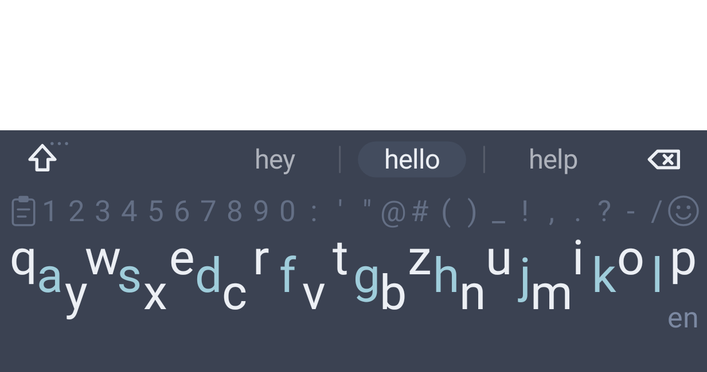
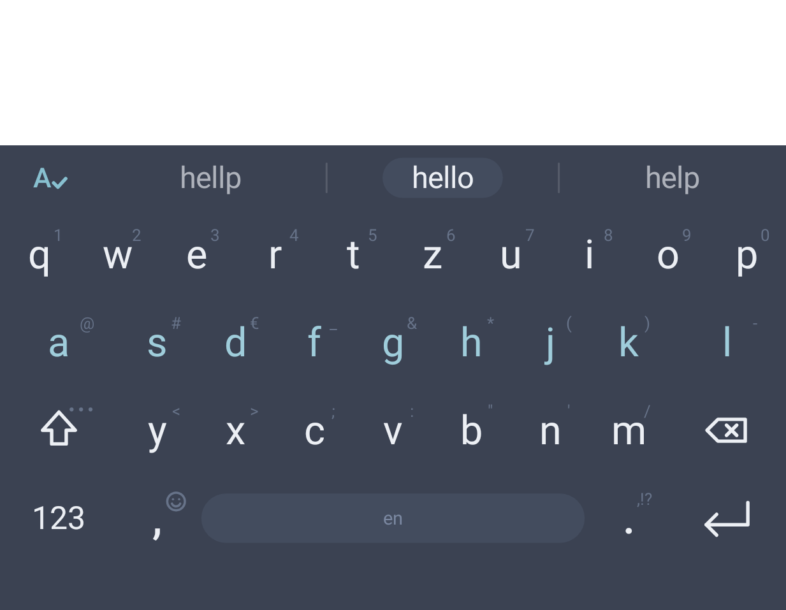
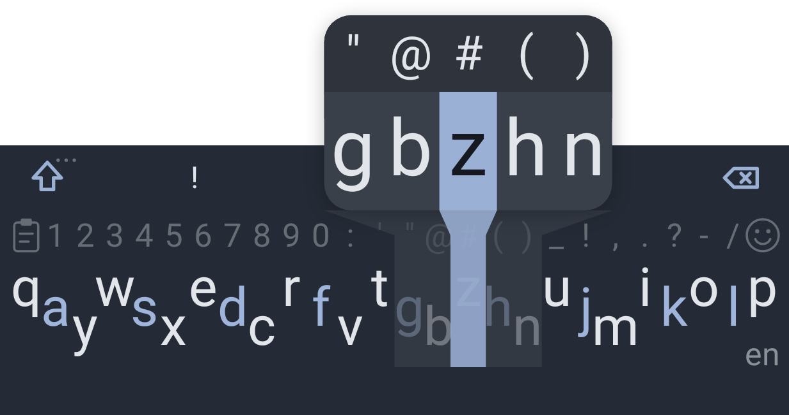
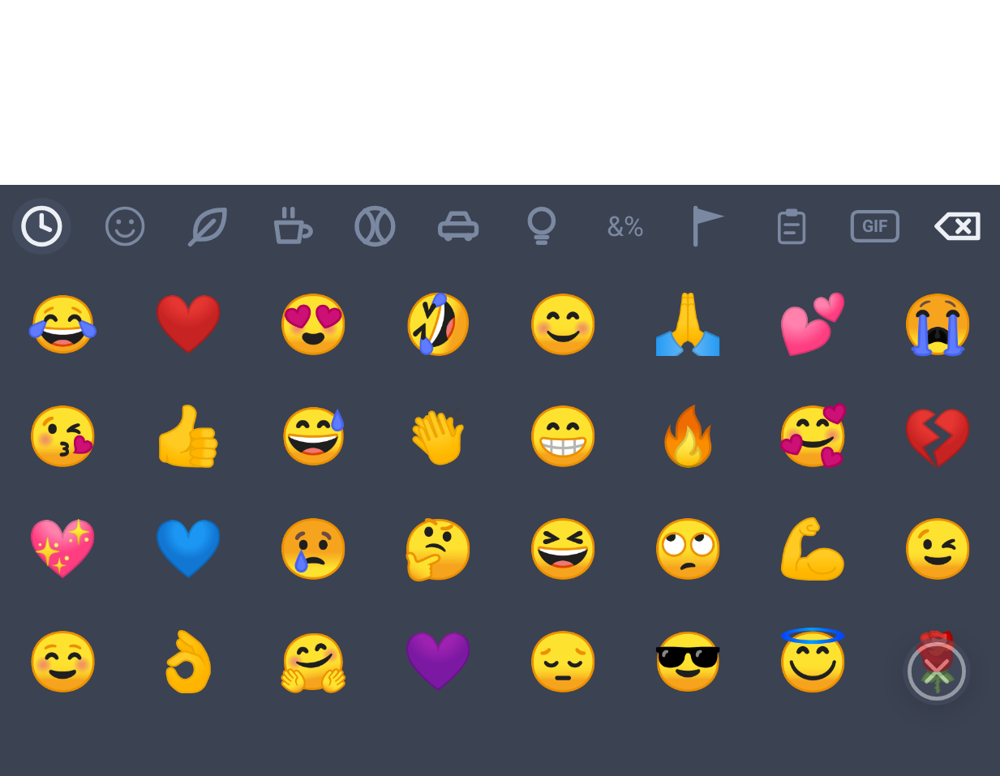
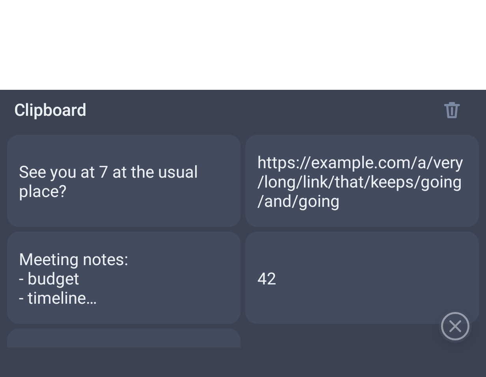
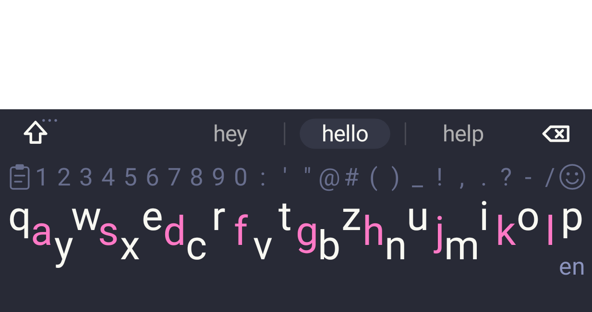
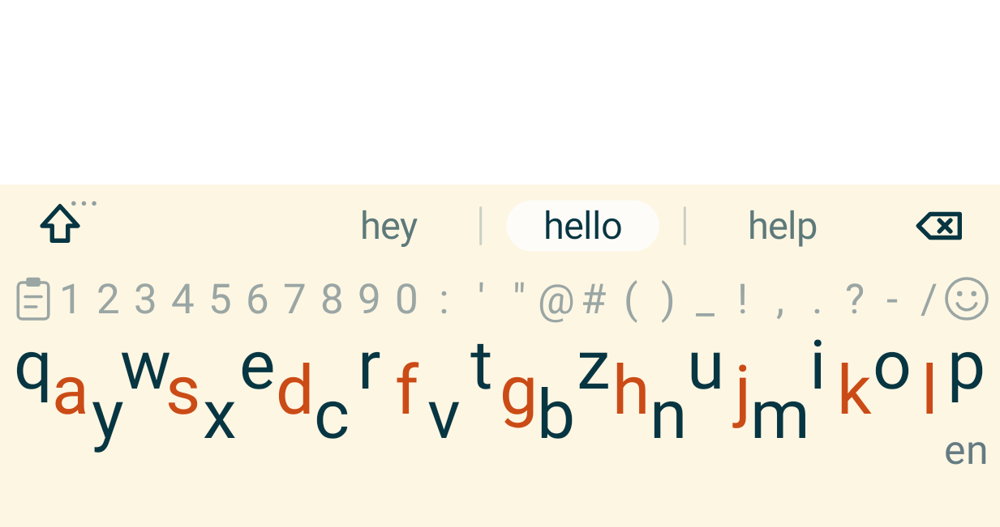
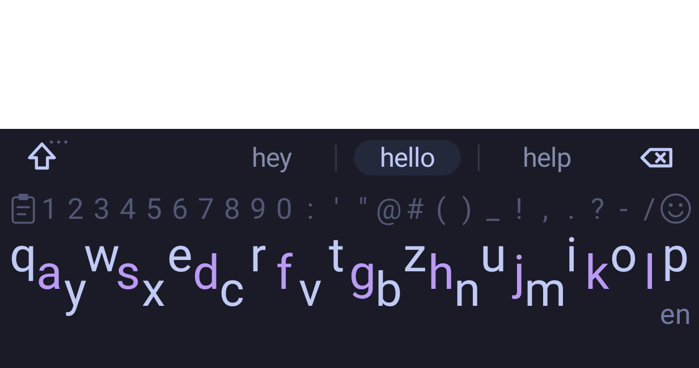
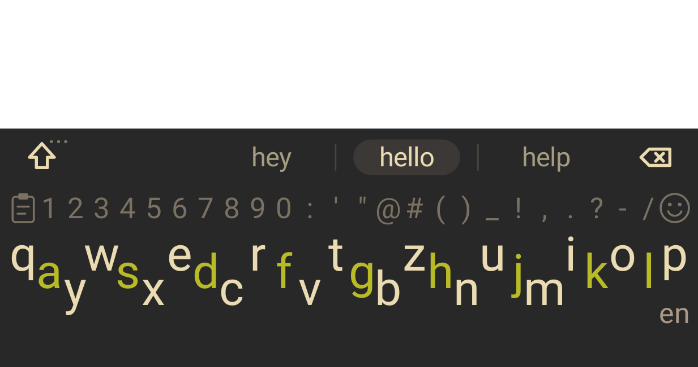
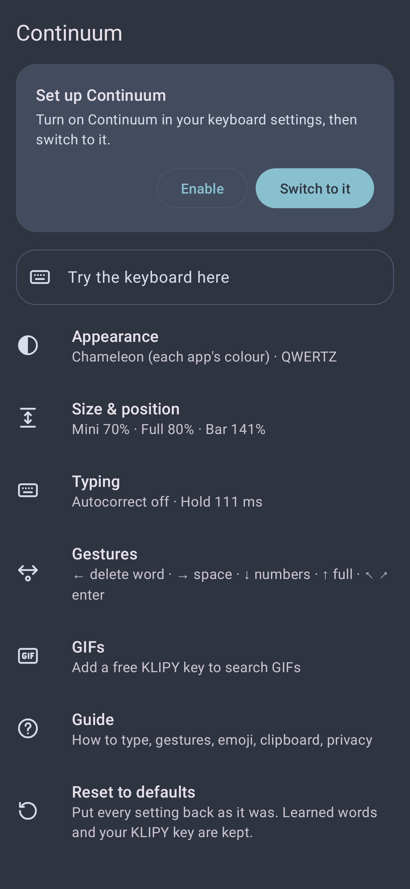

<div align="center">


# Continuum

**The one-row keyboard, back again.**
A from-scratch continuation of the discontinued **Minuum** keyboard for Android.

[](https://github.com/brownLlama/continuum/actions/workflows/build.yml)
[](https://github.com/brownLlama/continuum/releases/latest)

[**⬇ Download Continuum.apk**](https://github.com/brownLlama/continuum/releases/latest/download/Continuum.apk)


&nbsp;


</div>

---

## The story

Minuum, by Whirlscape, squeezed the whole keyboard into a **single row of letters**. You tapped roughly where the letters were and it worked out the word, leaving most of the screen for what you were typing. It was clever, fast and great for big thumbs on small screens. Then it was discontinued and slowly stopped working on new Android versions.

**Continuum** is my personal project to bring it back. It isn't a copy of the old app: everything (the keyboard, the word engine, the settings) is written from scratch for current Android. It keeps the idea and the feel, and adds what I missed: a full keyboard in the same style, typo correction, themes, emoji, a clipboard and GIF search.

> This is an independent, non-commercial personal project. It is not affiliated with or endorsed by Whirlscape or the original Minuum.

### Why "Continuum"?

The name works on three levels:

- **It continues Minuum.** *Continuum* literally holds the original's name: con**tinuum** / Mi**nuum**. The project picks up where Minuum left off.
- **The letter row really is a continuum.** In mini mode there are no separate keys to hit. The row is one continuous line, and each tap is just a point along it. Continuum doesn't ask "which key did you press?" but "where on the line did you touch, and which word fits those points best?". That's why rough taps still give the right word.
- **The icon says it too.** An infinity sign, the symbol for something that goes on, sits above mini mode's staggered row of keys: the Minuum row, carried on.

<p align="center"></p>

## Contents

- [Why "Continuum"?](#why-continuum)
- [Download and install](#download-and-install)
- [Features](#features)
- [Privacy](#privacy)
- [Build it yourself](#build-it-yourself)
- [How releases are made](#how-releases-are-made)
- [How it was built](#how-it-was-built)
- [Credits](#credits)

## Download and install

Continuum isn't on the Play Store. Install the APK straight from this repository:

1. **Download** [`Continuum.apk`](https://github.com/brownLlama/continuum/releases/latest/download/Continuum.apk) on your phone. It's always the latest version; older ones are on the [releases page](https://github.com/brownLlama/continuum/releases).
2. **Open** the downloaded file. Android will ask you to allow installs from your browser or file manager ("Install unknown apps"). Allow it, then tap **Install**.
3. **Open Continuum** from your app drawer. The setup card walks you through the last two steps:
   - **Enable**: turn Continuum on in Android's keyboard settings. Android shows a standard warning that keyboards can read what you type. Continuum keeps everything on your phone (see [Privacy](#privacy)).
   - **Switch to it**: make it your current keyboard.
4. Type in the **Try the keyboard here** field, then read the **Guide** page in the app for every trick.

**Requirements:** Android 8.0 (Oreo) or newer.

**Updating:** download and install the new APK over the old one. Your learned words and settings stay.

<details>
<summary>Check that the download is genuine</summary>

Each release lists the SHA-256 checksum of its APK in `SHA256SUMS.txt`. On a computer:

```sh
shasum -a 256 Continuum.apk   # compare with SHA256SUMS.txt
```

All releases are signed with the same key, so Android only accepts an update that really comes from this project.
</details>

## Features

### ⌨️ Mini mode: the whole keyboard in one row

All 26 letters in **one staggered row** (QWERTZ by default: `Q A Y W S X …`, or QWERTY), with a strip of numbers and symbols above it. Tap roughly where the letters are and Continuum works out the word from three things: where you tapped, how common each word is, and what *you* usually type.



- **Zoom for exact letters.** Hold on the row to magnify five letters, slide to the one you want and lift. Slide up instead to pick a number or symbol.
- **Space types the best guess.** The middle of the suggestion bar is the word space will type; the others are one tap away.
- **Double space** types a full stop, and the bar then offers `, ! ? …` to swap it for.
- **Capitals:** tap shift once for a capital, twice for caps lock. Auto-capitalisation is optional.
- A soft glow follows your finger along the row, so you can see where you're tapping.

<br clear="right">

### 🔤 Full keyboard, same style

Swipe up to get a normal keyboard drawn the same way: flat keys, one font, line icons.

- **Hold any key** for the small character in its corner (numbers on the top row, symbols on the rest).
- **Two pages** of numbers and symbols behind `123`, with a keypad-style number layout.
- An **autocorrect switch** in the suggestion bar. On, typos like *teh* become *the*. Off, every letter is typed exactly as tapped, which is handy for names and new words.

### 🧠 Word prediction that learns you

- A **probabilistic decoder**: each tap is scored against every possible word, weighted by word frequency and your own history. It answers in a few milliseconds per tap, even with 10,000 learned words.
- **Typo correction** handles missed, extra, doubled and swapped letters (*recieve* → *receive*, *helllo* → *hello*), but only takes over when it's clearly better than what you typed.
- **It learns your words**, how you capitalise and spell them, and which words tend to follow which. A brand-new word appears next to the best guess after you type it once, and becomes a normal suggestion after the second time.
- **Fix the last word:** backspace right after a word reopens it with its alternatives. Delete a word completely and the bar offers it back.
- **Next-word predictions** after a space, learned from the word pairs you actually type.
- **Hold a suggestion** to remove it for good.

### 👆 Gestures

| Swipe | Does |
|---|---|
| ← left | Delete the last word |
| → right | Space |
| ↑ up (mini mode) | Open the full keyboard |
| ↓ down | Switch between letters and numbers |
| ↓ down from the suggestion bar (full keyboard) | Back to mini mode |
| ↖ ↗ diagonally up | Enter |

How sensitive swipes are (shortest swipe, flick speed, long swipe, straightness) is adjustable, with an explanation for each slider.

### 😀 Emoji, 📋 clipboard and GIFs

<p>


</p>

- **Emoji panel:** every Unicode emoji, your most-used first, with tabs to jump between groups. Open it from the zoom (☺) or by holding the comma.
- **Clipboard:** your last 30 copies (kept for 7 days) as cards. Tap to paste, hold to delete. Anything copied from a password or private field is skipped.
- **GIF search** with [KLIPY](https://partner.klipy.com): search, tap and the GIF is sent as a real animated GIF (apps that can't take GIFs get the link). It needs your own free KLIPY key, entered in the app. Don't want GIFs? Turn off **Show GIFs** and the GIF and clipboard tabs disappear from the emoji panel (mini mode still opens the clipboard from its symbol row).

### 🎨 Themes

<p>




</p>

- **Chameleon** (the default): the keyboard takes on the colour of the app you're typing in, picked from the app's icon, so WhatsApp gets a green keyboard and Instagram a pink one. No two apps share a colour.
- Or a fixed theme: **Dark, Light, Nord, Nord Light, Dracula, Gruvbox, Solarized Dark, Solarized Light, Catppuccin, Tokyo Night, One Dark**.
- The home-row letters (A S D F …) are tinted so you can find your place at a glance.

### ⚙️ Settings



- **Appearance:** theme and layout (QWERTZ or QWERTY).
- **Size & position:** separate heights for the mini keyboard, the full keyboard and the suggestion bar, plus the space under the keys. The keys always sit above Android's navigation bar or gesture handle. On Android 16+ you can hide Android's own keyboard buttons to get that space back.
- **Typing:** autocorrect, auto-capitalisation, press-and-hold time, and *Forget learned words*.
- **Gestures:** swipe sensitivity, each slider explained.
- **GIFs:** show or hide the emoji panel's GIF and clipboard tabs, and your KLIPY key.
- **Guide:** everything about using the keyboard, right in the app.
- **Reset to defaults:** one tap puts every setting back (learned words and your KLIPY key are kept).

Every slider starts in the middle of its range, so there's as much room to go up as down.

<br clear="right">

## Privacy

A keyboard sees everything you type, so this matters:

- **Nothing you type leaves your phone.** Word prediction, learning and the clipboard all run and stay on the device.
- **The only network use is GIF search.** When you search, the search words, an anonymous ID and your KLIPY key go to `api.klipy.com` over HTTPS. Nothing else is ever sent.
- **No cloud backup:** learned words, settings and your KLIPY key are excluded from Android backup and device-to-device transfer.
- **Password and number fields** are never predicted or learned from, and private (incognito) fields teach it nothing.
- **Permissions:** only Internet, used for GIFs. No contacts, no storage, no location, no vibration.
- **HTTPS only:** plain-HTTP traffic and user-installed certificate authorities are refused.

## Build it yourself

You need [Android Studio](https://developer.android.com/studio) (or JDK 17+ and the Android SDK).

```sh
git clone https://github.com/brownLlama/continuum.git
cd continuum
./gradlew assembleDebug
adb install -r app/build/outputs/apk/debug/app-debug.apk
```

Or open the folder in Android Studio and press **Run**.

<details>
<summary>Project layout</summary>

All code lives in `app/src/main/java/com/brownllama/continuum/`:

| Package | What's in it |
|---|---|
| *(root)* | `ContinuumIME` (the keyboard service: editing, composing, learning), `SettingsActivity`, `Prefs` |
| `keyboard/` | `KeyboardView`, a single custom view that draws and handles everything; layouts, icons, emoji |
| `prediction/` | `Decoder` (tap → word scoring and typo correction), `Dictionary`, `UserModel` (learned words) |
| `theme/` | `KeyboardTheme` (the presets) and `AppThemes` (Chameleon's per-app colours) |
| `gif/` | KLIPY client and the GIF feed |
| `clipboard/` | Clipboard history |

The word list is the top 45,000 English words from [hermitdave/FrequencyWords](https://github.com/hermitdave/FrequencyWords).
</details>

## How releases are made

Two GitHub Actions workflows live in `.github/workflows/`:

- **Build** (`build.yml`) builds the app on every push and pull request. The debug APK is attached to each run as an artifact.
- **Release** (`release.yml`) runs when a version tag is pushed. It builds a signed release APK, attaches it (plus checksums) to a new GitHub release with generated release notes, and that release becomes the download link above.

```sh
git tag v1.0.0
git push origin v1.0.0
```

Signing uses four repository secrets: `SIGNING_KEYSTORE_BASE64`, `SIGNING_STORE_PASSWORD`, `SIGNING_KEY_ALIAS` and `SIGNING_KEY_PASSWORD`. For local release builds, put the same values in a git-ignored `keystore.properties`.

## How it was built

Continuum is a personal project, made because I missed Minuum. I designed it, decided how it should look and behave, and tested every version on my own phone. The decoder, the learning model and the typo correction were shaped by reading how open-source keyboards such as AOSP LatinIME solve the same problems.

If you find a bug or something that feels off, please [open an issue](https://github.com/brownLlama/continuum/issues).

## Credits

Full licence texts and notices are in [THIRD_PARTY_NOTICES.md](THIRD_PARTY_NOTICES.md).

- **Minuum** by Whirlscape, the original one-row keyboard this project continues in spirit.
- Word frequencies from [hermitdave/FrequencyWords](https://github.com/hermitdave/FrequencyWords), built from [OpenSubtitles](https://opus.nlpl.eu/OpenSubtitles.php) (word lists under [CC BY-SA 4.0](https://creativecommons.org/licenses/by-sa/4.0/); `app/src/main/assets/words.txt` is a trimmed copy and stays under the same licence).
- Common misspellings from Wikipedia's [Lists of common misspellings](https://en.wikipedia.org/wiki/Wikipedia:Lists_of_common_misspellings/For_machines) (CC BY-SA 4.0).
- Emoji data from Unicode's [emoji-test.txt](https://unicode.org/Public/emoji/16.0/emoji-test.txt) (Unicode License V3).
- AndroidX, Material Components and the Kotlin standard library (Apache 2.0).
- Colour palettes (colour values only) from [Nord](https://www.nordtheme.com/), [Dracula](https://draculatheme.com/), [Gruvbox](https://github.com/morhetz/gruvbox), [Solarized](https://ethanschoonover.com/solarized/), [Catppuccin](https://catppuccin.com/), [Tokyo Night](https://github.com/enkia/tokyo-night-vscode-theme) and [One Dark](https://github.com/atom/atom/tree/master/packages/one-dark-ui).
- GIF search by [KLIPY](https://klipy.com).
